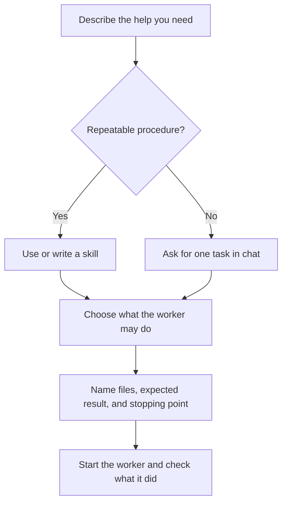

# Choose a skill or an agent role

Use this guide with [level 3](level-3-skill.md) and [level 4](level-4-agent.md).
A **skill** is a set of instructions you can reuse. An **agent role** gives
a worker a job and limits on what it may do.

## Choose what you need

| Need | Use |
| --- | --- |
| Repeat the same checks | A skill with the steps written down |
| Put a worker in charge of one job | An agent role with clear limits |
| Ask for one small change | A chat request; you may not need a new skill or role |
| Get a second opinion | A different worker who did not write the change |

Two workers can use the same skill but have different jobs. The coding worker
may edit approved files. A read-only reviewer may check the work and report
problems, but must leave the files unchanged.



## Start with the workshop examples

- Use [bootstrap-lab](../.agents/skills/bootstrap-lab/SKILL.md) to set up your
  project or its Python environment.
- Use [stop-slop](../.agents/skills/stop-slop/SKILL.md) to write plain language.
- Use [frontend-design](../.agents/skills/frontend-design/SKILL.md) if your idea
  has a screen or page people will use. Ask for a design your Python project
  can run; this skill does not require Node.
- Consult the [Copilot engineering role](../.github/agents/software-engineering-expert.agent.md)
  or [OpenCode engineering role](../.opencode/agents/software-engineering-expert.md)
  for coding and review jobs.

Use the copies installed in [level 0](level-0-bootstrap.md). Keep repeated
steps in skills instead of copying them into each agent role.

## Name the skill in your request

Paste these examples into agent chat. In OpenCode, replace `/stop-slop`
with `@stop-slop` and `/frontend-design` with `@frontend-design`.

```text
/stop-slop Write a short README for my project using BRIEF.md.
Explain what someone can do with it and how to try it.
Do not add features or change code.
```

```text
/frontend-design Plan a screen for [the feature in my brief].
Use BRIEF.md. Keep it within our Python setup.
Show a layout and explain what someone would click or type.
Wait for my approval before writing code.
```

## Give an agent a clear job

Tell the worker what job it has, which files to read, what it may change,
what result to return, and when to stop. "Be an expert" leaves those choices open.

For example:

```text
Use software-engineering-expert to fix [one problem] from BRIEF.md.
Follow the engineering agent's instructions. Leave unrelated features alone.
Explain the cause and planned change before editing.
After I approve, fix the problem and report the checks.
Ask a different worker to review without editing.
Return the changed files, results, and review.
```

After the change, use the skill you created in level 3. Use `@check-work`
in OpenCode:

```text
/check-work Check the fix and the examples that worked before.
Report results without changing files.
```

## Check what happened

Look in the chat's activity for the worker starting, the skill loading,
and the checks running. Ask your facilitator to help you find that activity.
An agent saying it used a worker or skill does not prove those steps happened.

If you cannot start a second worker, use a separate chat for review.
Record "review pending" until you receive the review.

[Work with two agents](two-agents.md) shows the review steps.
Use [Start a fresh session with a handoff](handoff-fresh-session.md)
to transfer the project without pasting the whole old conversation.
