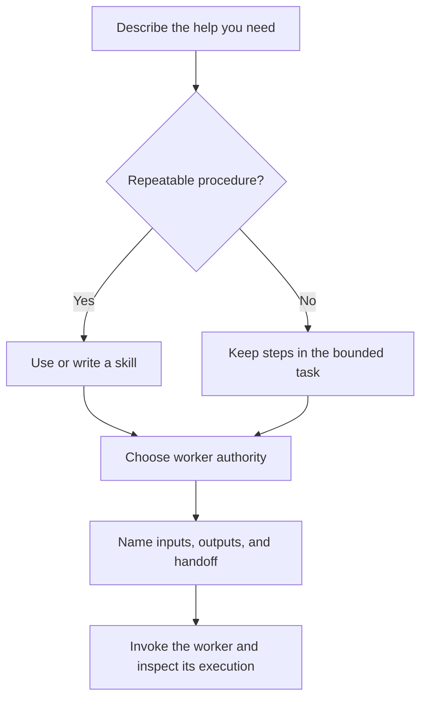

# Choose a skill or an agent role

Use this reference when you need repeatable steps, a focused worker, or a
second opinion. It supports [level 3](level-3-skill.md) and
[level 4](level-4-review.md).

## Choose what you need

| Need | Use |
| --- | --- |
| Repeat the same check procedure | A skill with steps and resources |
| Give a worker a bounded responsibility | A role with authority and handoff limits |
| Ask for one small change | A task prompt using the existing role and skills |
| Get an independent review | A separate worker who did not implement the change |

You can ask an implementer and a reviewer to use the same check-work skill.
Give each worker its own authority: an implementation role may edit approved
files; a read-only reviewer may report findings but must not implement fixes
for that change.



## Start with the workshop examples

- Use [bootstrap-lab](../.agents/skills/bootstrap-lab/SKILL.md) for setup and
  planning procedures.
- Use [stop-slop](../.agents/skills/stop-slop/SKILL.md) for prose.
- Use [frontend-design](../.agents/skills/frontend-design/SKILL.md) if your idea
  includes a UI. Keep its implementation within the workshop's Python/PyPI
  environment; a design skill does not require a Node project.
- Consult the [Copilot engineering role](../.github/agents/software-engineering-expert.agent.md)
  or [OpenCode engineering role](../.opencode/agents/software-engineering-expert.md)
  for contribution and review boundaries.

Use the installed copy for your harness, following
[level 0](level-0-bootstrap.md). Keep reusable execution steps in skills rather
than pasting them into each role.

## Copy this focused task prompt

```text
Role: [implementer / independent read-only reviewer].
Authority: [allowed edits and checks]; ask before [restricted actions].
Inputs: AGENTS.md, BRIEF.md, [task evidence and file scope].
Skill: invoke [skill name/path] for [procedure].
Output: [change or findings], exact checks/results, and verification gaps.
Handoff: stop after [bounded task]; [person/worker] handles [next action].
Do not expand scope or change acceptance criteria without my approval.
```

Name concrete boundaries. “Be an expert” gives the worker no file scope,
permission limit, or stopping point.

## Optional example: check and review one fix

You might ask the engineering role to fix one approved input-validation bug,
use check-work, and report its changed files. After implementation stops, give
a fresh worker the brief, changed files, before/after evidence, and results.

Give that reviewer read-only authority. Ask for failing inputs and
reproduction steps, then return confirmed bugs to the implementer.
[Work with two agents](two-agents.md) describes that sequence. You approve the
fix and verify its behavior before accepting it.

## Check that the worker used the procedure

A role label does not launch a worker, and a skill name does not prove execution.
Use your harness's supported controls and inspect the response or tool trace.
If skill discovery fails, provide its exact installed path and ask the worker
to read and follow it. Check the reported steps and results.

If your harness cannot spawn a worker, start an independent session for review
and supply the same bounded inputs. Mark the review pending until you receive
its findings. Use [Start a fresh session with a handoff](handoff-fresh-session.md)
to transfer context without pasting the whole conversation.
