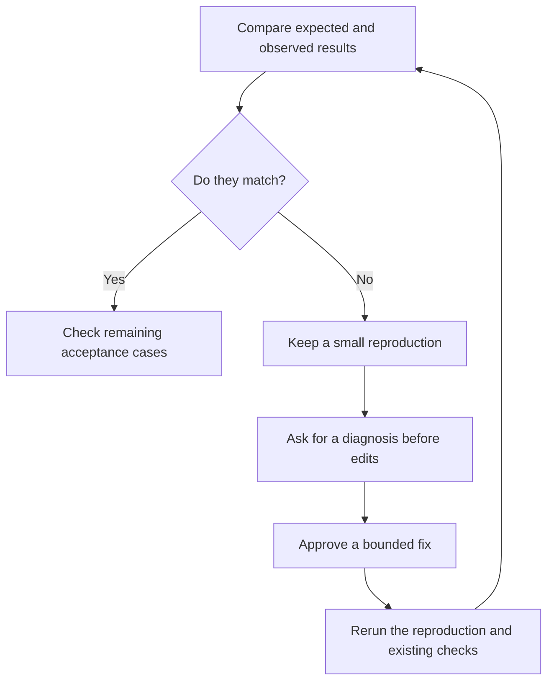

# Check and debug agent work

Use this reference when an agent says “done,” a check fails, or a feature
misses an acceptance criterion. It supports
[level 2](level-2-build.md) and [level 4](level-4-review.md).

## Compare a claim with an observation

Review the changed code and dependencies before running them. Use fixture data.
Pick an acceptance check from your brief and compare its expected result with
what you observe through the project's intended interface.

| Agent's claim | Evidence to inspect |
| --- | --- |
| “The tests pass.” | Exact command, working directory, interpreter, and result |
| “I fixed the bug.” | Original failing input before and after the change |
| “The feature works.” | Your acceptance example through its intended interface |
| “Nothing else broke.” | Relevant existing checks and known verification gaps |

A skipped check remains unchecked. If you cannot run it, name the gap instead
of counting the agent's confidence as evidence.



## Keep the failure small

Use the fewest fixture records or actions that still reproduce the mismatch.
Keep the original expected result. Note whether you can repeat the failure
from the same starting state.

Separate a setup failure from a behavior failure. An unavailable interpreter
or missing package does not prove that the feature is wrong. Follow the
[workshop environment guidance](start-here.md#paths-and-python) if you need a
dependency; do not install it into system Python.

## Copy this diagnosis prompt

```text
Role: diagnose this mismatch before changing code.
Inputs: AGENTS.md, BRIEF.md, changed files, and this reproduction:
  Starting state and fixture input: [...]
  Exact command or manual steps: [...]
  Expected result: [...]
  Observed result and error text: [...]
Authority: inspect relevant code and run approved, safe checks;
do not edit files or change acceptance criteria.
Output: likely cause, supporting evidence, uncertainties, and a bounded fix.
Handoff: stop for my approval before implementation.
```

Share relevant error text and synthetic inputs. Remove credentials and private
records before giving them to an agent.

## Optional example: a duplicate result

Suppose a “find matching records” action returns the same fixture record twice.
Reduce the input to one matching record. Note whether duplicates appear in the
underlying result or only in the interface.

Ask the agent to trace that record through the relevant code. Approve a fix
after it identifies evidence for the cause. The implementer should add a check
that catches the duplicate and preserve valid multiple matches.

## Close the loop yourself

After the fix, rerun the original reproduction and the relevant existing
checks. Try the user action too; a unit test may not cover the interface.
Reuse your [check-work skill](level-3-skill.md) for the project's procedure.

For an independent review, use a worker who did not implement this change.
Give them read-only authority and the before/after evidence described in
[Work with two agents](two-agents.md). A diagnosis from the implementer does
not count as that independent review. You decide whether to accept the change.
