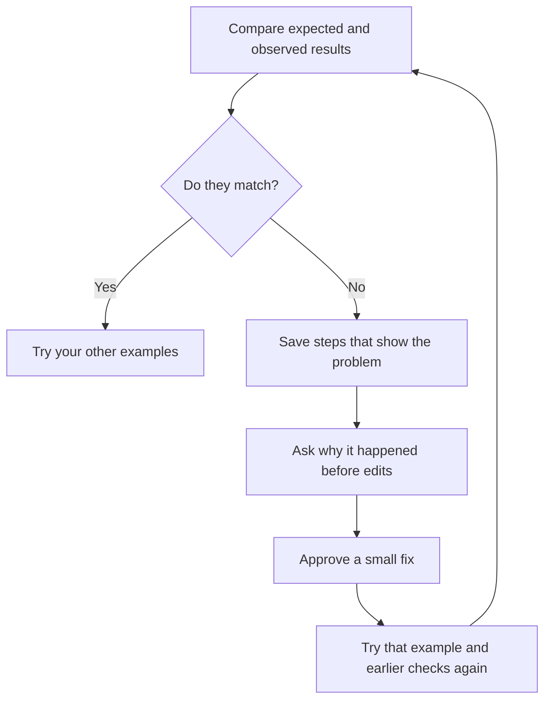

# Check and debug agent work

Use this guide when an agent says "done" but you have not tried the result,
or something does not work as you expected. It supports
[level 2](level-2-build.md) and [level 4](level-4-review.md).

## Compare a claim with an observation

Ask the agent to explain its changes and any new packages before you approve
running them. Use made-up data. Pick an example from your brief, try it,
and compare what happened with what you expected.

| Agent's claim | Evidence to inspect |
| --- | --- |
| “The tests pass.” | Which checks ran, in which folder and Python environment, and their results |
| “I fixed the bug.” | Your original example, tried again after the fix |
| “The feature works.” | Your own attempt to use the feature |
| “Nothing else broke.” | Results from trying examples that worked before |

If the agent skipped a check, record that you do not know its result.
Ask for results, not a confident claim.



## Keep the failure small

Write down the shortest set of steps that shows the problem. Keep the sample
information you used and copy the error message. Try those steps again to see
whether the same thing happens.

Ask whether the problem comes from setup or from your feature. A missing
package does not mean the feature's code is wrong. Follow the
[workshop environment guidance](start-here.md#paths-and-python) if you need a
dependency; do not install it into system Python.

## Ask what went wrong

Paste this into chat. This is a question for your agent, not a new skill:

```text
Help me understand this problem. Read AGENTS.md and BRIEF.md.
I started with: [sample information].
I did: [steps I tried].
I expected: [result from my brief].
What happened: [actual result and any error message].
Read the relevant code and run approved checks, but do not edit files yet.
Explain what you think caused it and what evidence supports that explanation.
Suggest a small fix and wait for my approval.
```

Use made-up examples. Remove passwords, access keys, and private information
from error messages before sharing them.

## Optional example: a duplicate result

Suppose your project searches a list and shows the same item twice.
Try a sample list with one item that should match. Save what the project
shows you.

Ask the agent to follow that item through the code and explain where the
duplicate comes from. Approve a fix after you understand its explanation.
Ask it to add a test that would catch the same problem next time.

## Close the loop yourself

After the fix, try your original steps again. Ask the agent to rerun earlier
checks too. Once you have made [check-work in level 3](level-3-skill.md), use it
by name. In OpenCode, use `@check-work`:

```text
/check-work Check the fix for [the problem].
Run the check for our original failing example and the earlier checks.
Report what passed, failed, or could not be checked. Do not change files.
```

For a second opinion, ask a different worker to review the change without
editing it. [Work with two agents](two-agents.md) shows what to give that
reviewer. You decide whether to accept the fix.
