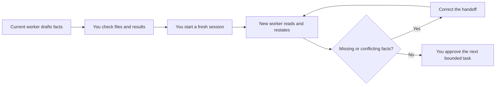

# Start a fresh session with a handoff

Use this reference when a session grows hard to follow, you switch workers,
or you return to your project after a break. It supports
[level 5](level-5-context.md); keep the handoff compact enough to inspect.

## Put each fact where you can find it

| Fact | Home |
| --- | --- |
| Approved behavior and deferred work | `BRIEF.md` |
| Reusable check procedure | Your project's `check-work` skill |
| Current state, unresolved findings, and next task | `HANDOFF.md` |
| Detailed fixtures or long results | A referenced project file |

Keep stable constraints in project instructions. Avoid copying their full text
into the handoff. Link the source and note a constraint that affects the next
task. Resolve conflicting instructions before asking an agent to edit.



## Copy this handoff template

Use these fields in the handoff from level 5. Omit a field that has no bearing
on the next task rather than filling it with chat history.

```text
Goal and approved scope: [brief path and relevant section]
Current behavior: [what works and the files that support this claim]
Decisions: [choice, reason, and source]
Environment: [project directory and selected Python/venv interpreter]
Checks: [exact commands or manual steps, results, and when they ran]
Gaps: [failures, skipped checks, unresolved review findings]
Next task: [one change, acceptance examples, and allowed file scope]
Preserve: [existing behavior and data contracts]
Leave out: [deferred work and actions requiring human approval]
References: [skill path, fixtures, and detailed results]
```

Treat results from before the latest edit as historical evidence. State which
version of the work they cover. Include failed checks that still affect the
next task, even if another check passed.

## Ask the next worker to recover the task

Start a fresh session through your harness's supported controls. A request to
“start fresh” inside the old chat does not prove that you started a new session.
Use this prompt after supplying the project:

```text
Role: recover context for the next implementation task.
Inputs: read AGENTS.md, BRIEF.md, HANDOFF.md, and the named check-work skill.
Authority: inspect the project; do not edit files yet.
Output: restate the next task, acceptance examples, constraints, and gaps.
Name the files you read and any handoff claims you could not verify.
Handoff: wait for my approval before implementing the bounded task.
```

Check the restatement against your brief. Correct a missing fact in the
handoff so the next worker can find it without reconstructing the old chat.

## Optional example: preserve a rejected input

Suppose the next task adds a new sort order. Your previous session found that
an empty input must produce a clear message without changing saved data.
Name that behavior and its check in the handoff. The fresh worker should
preserve it while adding the sort order.

## Check execution after the handoff

Harnesses differ in compaction and worker support. Inspect any generated
summary; do not assume it includes approvals, failed checks, or deferred work.
You must start the next session and receive its response to complete the
transfer.

After approving implementation, inspect the change and run the acceptance
and regression checks. A good restatement proves context recovery, not working
code. Use [Check and debug agent work](debug-agent-work.md) for mismatches and
[Work with two agents](two-agents.md) for an independent review.
