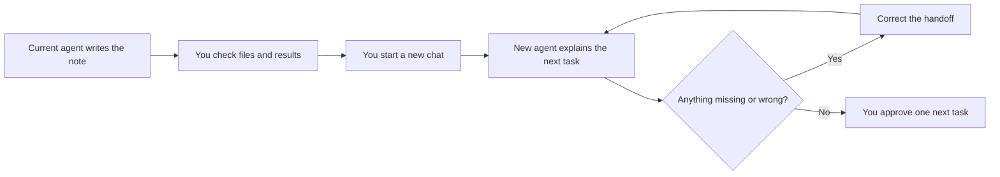

# Start a fresh session with a handoff

Use this guide when a chat grows hard to follow or you return to your project
after a break. It supports [level 5](level-5-context.md). A **handoff** is a
short note telling the next agent what works and what to do next.

## Put each fact where you can find it

| Fact | Home |
| --- | --- |
| What you agreed to build and what can wait | `BRIEF.md` |
| Steps for checking the project | Your project's `check-work` skill |
| What works, remaining problems, and next task | `HANDOFF.md` |
| Long sample data or check results | A project file you link to |

Keep working rules in `AGENTS.md`. Link to that file instead of copying all
its text into the handoff. If two files give different instructions, ask the
agent to explain the conflict and help you choose before it changes the app.



## Ask for a handoff note

Use `stop-slop` to write the note in plain language. Paste this into the
current chat; use `@stop-slop` in OpenCode:

```text
/stop-slop Write HANDOFF.md for a new chat.
Use AGENTS.md, BRIEF.md, the project files, and our latest check results.
Say what works, what we decided, and which files explain those decisions.
Include how to run the project and the Python environment we used.
List unfixed problems, failed checks, and checks we could not run.
The next task is [one task]. Include its examples and expected results.
Say what must keep working and what needs my approval.
Link to longer files and keep the note short. Do not change the app.
```

Check the note yourself. A test result from before the latest change may no
longer describe your project. Ask the agent to say when it ran the checks
and keep any failures the next agent needs to know about.

## Ask the next worker to recover the task

Use your app's new-chat control while keeping the project open. Ask your
facilitator where to find it. Then paste this into the new chat:

```text
Read AGENTS.md, BRIEF.md, and HANDOFF.md.
Explain what the project does and the next task in your own words.
Tell me what results to expect and what must keep working.
Name the files you read and anything missing or unclear.
Do not change files until I approve the task.
```

Compare its answer with your brief. Correct missing or wrong facts in
`HANDOFF.md`, then ask the new agent to read the corrected note.

## Optional example: preserve a rejected input

Suppose your next task adds a way to sort saved items. You already decided
that leaving a required field blank should show a message and leave saved
information unchanged. Put that decision and its check in the handoff.
Ask the new agent to keep it working when it adds sorting.

## Check execution after the handoff

Some apps can summarize an old chat. Read any summary for missing decisions.
In level 5, open a new chat and get a response from the new agent; a summary
inside the old chat does not complete that step.

After approving the task and receiving the change, use your checking skill.
In OpenCode, use `@check-work`:

```text
/check-work Check the new change and the examples that worked before.
Report what passed, failed, or could not be checked.
```

Try the feature yourself. Use [Check and debug agent work](debug-agent-work.md)
if it differs from your plan and [Work with two agents](two-agents.md) for a
second opinion.
