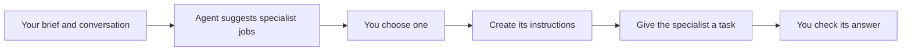

# Level 4: Make a specialized subagent

## Goal

Create a subagent for your project's needs, then give it a real task.

## Choose a useful job

In level 3, you made a skill with steps the agent can reuse. A **subagent** is a separate worker your coding agent can ask for help. You give it a focused job, the information it needs, and limits on what it may do.

The starter `software-engineering-expert` handles coding and review. Your new specialist should help with something specific to the idea in `BRIEF.md`. For a quiz game, it could check whether questions have one clear answer. For a schedule planner, it could look for activities that overlap. These are examples; choose a job for your project.

Ask the bootstrap skill for suggestions based on what you have discussed and built. Paste this into chat; use `@bootstrap-lab` in OpenCode:

```text
/bootstrap-lab Suggest two specialized subagents for this project.
Use our current conversation, BRIEF.md, and what we have built so far.
For each suggestion, give it a short name and explain:
- What project-specific job would it do?
- When would we ask it for help?
- What files or examples would it need?
- What should it return, and what must it leave alone?
Recommend one that would help with our next task.
Do not create files until I choose.
```

Choose one suggestion, or ask for a different one. Keep its first assignment small enough that you can check its answer yourself.



## Create its instructions

Use the skill again after choosing the job. Replace the brackets; use `@bootstrap-lab` in OpenCode:

```text
/bootstrap-lab Create the [chosen name] subagent we agreed on.
Use stop-slop to write its instructions for my coding app.
Give it the job, needed information, expected answer, and stopping point
we chose from BRIEF.md and our conversation.
For this first version, let it read and report, but not edit files.
Keep repeated procedures in skills and link any skill it needs.
Do not copy the whole brief or the engineering agent's instructions.
Show me the proposed agent file before saving it.
```

Read the proposal and ask the agent to explain anything unclear. Approve the file once you can describe the specialist's job and limits.

| App | Where your agent file belongs |
| --- | --- |
| Copilot | `.github/agents/[chosen-name].agent.md` |
| OpenCode | `.opencode/agents/[chosen-name].md` |

Let your coding agent choose the settings for your app. Keep the role focused on what this specialist needs to do.

## Give the specialist a task

Ask your coding agent to start the new subagent. This is an agent request, not a skill command:

```text
Dispatch the [chosen name] subagent for this task: [one small task].
Give it the relevant part of BRIEF.md and this example: [sample].
Have it follow its saved instructions and return its answer without editing files.
Show me its response and explain how I can check it.
```

Look in the chat's activity for the separate worker and its response. Ask your facilitator to help you find the app's agent controls if needed. Saving an agent file does not run that agent.

Compare its answer with your sample and the goal in your brief. For a question checker, inspect the answer it flagged. For a schedule checker, look at the times it says overlap. Use an example from your own idea.

## Evidence and checkpoint

Save the suggestions, your chosen job, the agent file, and the specialist's response. Explain how its answer helps your project and show how you checked it. Confirm that it left project files unchanged.

<details>
<summary>Hint</summary>

Choose a job with a clear answer you can inspect. "Help with my app" is too broad. Ask what part of your idea needs a second pair of eyes.

</details>

Previous: [Level 3: Make a check-work skill](level-3-skill.md) · Next: [Level 5: Extend and review](level-5-review.md)
