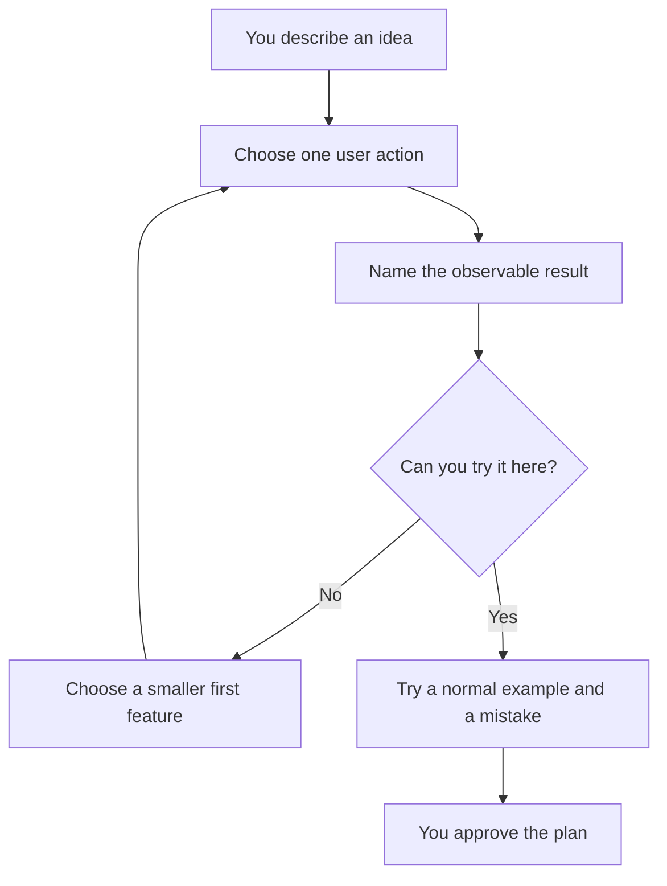

# Turn an idea into a check

Use this guide with [level 1](level-1-brief.md) when you have an idea but do
not know what to ask the agent to build first. Add your choices to `BRIEF.md`;
you do not need another plan.

## Find the action you can try

Picture one person using your project. What would they type, click, or give it?
What should they see when they do that? You can choose how someone uses your
project; ask the agent to explain which options fit the workshop computer.

Replace "make it easy to organize things" with one example someone could try.
Describe what they start with, what they do, and what should happen.
If you cannot choose a first feature, ask the agent for two smaller options.



## Separate a requirement from a guess

Ask these questions before approving the plan:

| Choice | Question to settle |
| --- | --- |
| What the person gives it | What will they type, click, or provide? |
| What they get back | What should they see or receive? |
| What gets saved | What should change, and what must stay safe if something goes wrong? |
| A mistake to try | What should happen if they leave something blank or repeat an action? |

Choose one mistake that matters to your idea. Ask the agent what it should do
when that mistake happens, then decide whether you agree.

## Ask for a small first version

Paste this into chat. In OpenCode, use `@stop-slop`:

```text
/stop-slop Help me plan one feature for [idea and who will use it].
Read AGENTS.md. Keep the plan inside our workshop's Python setup.
Describe what someone starts with, what they do, and what they should see.
Add one mistake they could make and what should happen.
Say what information must stay safe if that action fails.
Explain choices I need to make and leave extra features for later.
Add the plan to BRIEF.md and wait for my approval. Do not write code yet.
```

Ask the agent to explain how you could try each example. You should be able
to tell a classmate what to do and what result to look for.

## Optional example: group some notes

If you choose an idea for grouping notes, your first feature could be:

- Start with two made-up notes: “buy tea” and “call Sam.”
- Assign the label “errands” to “buy tea.”
- Check that the selected note has that label and “call Sam” stays unchanged.
- Try assigning a label to a missing note. Expect a clear failure and no change
  to the existing notes.

Ask the agent how you could try that action on your workshop computer.
Search and accounts can go on your "Later" list. Use made-up notes while
you build and check the feature.

## Keep the first version small

If your full idea needs a service you cannot use here, ask for a version that
uses made-up data on this computer. Write down what it cannot do. A demo using
sample data does not show that you connected to the real service.

Approve any change to the plan before the agent writes code for it.
Carry your examples into [level 2](level-2-build.md). Use
[Check and debug agent work](debug-agent-work.md) if the result differs
from what you expected.
