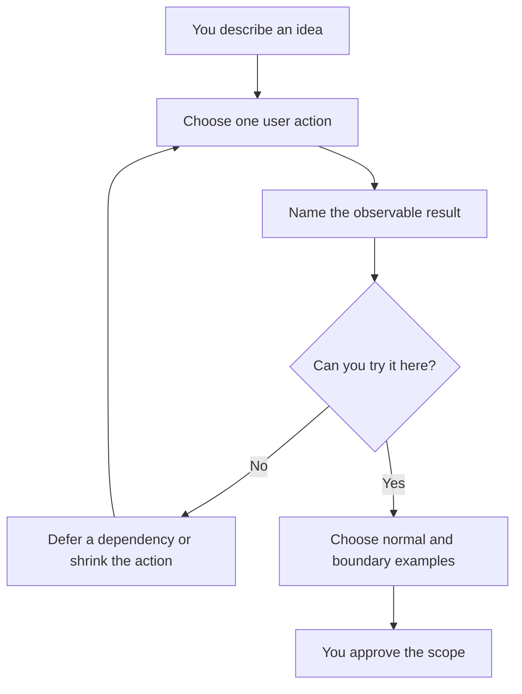

# Turn an idea into a check

Use this reference when your idea sounds useful but you cannot tell an
agent what success looks like. It supports [level 1](level-1-brief.md);
you do not need another planning document.

## Find the action you can try

Describe one person using the first version. Name what they provide, what they
do, and what they should see or receive. Choose an interface that suits your
idea: a function, local page, file operation, or another Python-based interface.

Replace broad goals such as “make it easy to organize things” with a check:
“Given this starting state, after this action, I can observe this result.”
If you cannot name the result, ask the agent to propose two smaller behaviors
and choose one yourself.



## Separate a requirement from a guess

Before approving the first behavior, resolve choices that change its result:

| Choice | Question to settle |
| --- | --- |
| Input | What does the user supply, and what counts as invalid? |
| Output | What can the user inspect to tell that the action succeeded? |
| State | What should change, and what must survive a failed action? |
| Boundary | What should happen with an empty, missing, or repeated input? |

Pick a boundary that matters to your idea. You do not need cases for each row
before you can begin.

## Copy this scope prompt

```text
Role: help me scope one behavior; do not implement it.
Inputs: AGENTS.md and this idea: [idea and intended user].
Authority: propose choices; I approve scope and acceptance criteria.
Output: one action, starting state, input, observable result, and
one meaningful failure or boundary case. Name what must remain unchanged.
Fit Python 3.9+ and the workshop's Python/PyPI environment.
Handoff: list unresolved choices and deferred work, then stop for approval.
```

Ask the agent to explain how you could check each expected result. A test name
without an input and expected outcome leaves you guessing.

## Optional example: group some notes

Suppose your idea helps someone group short notes. You could choose this slice:

- Start with two fixture notes: “buy tea” and “call Sam.”
- Assign the label “errands” to “buy tea.”
- Check that the selected note has that label and “call Sam” stays unchanged.
- Try assigning a label to a missing note. Expect a clear failure and no change
  to the existing notes.

You could expose this behavior through a function or an interface you choose.
Search, accounts, and synchronization can wait. Use synthetic notes while you
work out the behavior.

## Cut scope without moving the goal

If the slice needs an unavailable service, choose a local fixture or prototype
and name what it cannot prove. Do not describe a fixture-backed prototype as a
working integration.

Approve changes to the expected behavior before the agent changes code or
tests to match them. Carry the chosen examples into
[level 2](level-2-build.md). Use [Check and debug agent work](debug-agent-work.md)
when the observed result differs from the one you approved.
