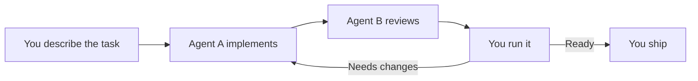

# Work with two agents

Give one agent a bounded implementation task. After it stops, give an independent worker a read-only review. You can use one supplied harness for both roles: Copilot general-purpose or OpenCode general.

Use this guide with [level 4 review](level-4-review.md) and [level 5 context](level-5-context.md). Keep shared-file edits with one agent at a time. You need no Git worktrees or second harness installation.

## Keep the loop short



Give the reviewer the brief, acceptance criteria, changed-file scope, and diff or before/after excerpts. Use an independent session if your harness cannot spawn a worker. Mark the review pending until you receive its result.

```text
Review the supplied change against this goal:
[paste the goal and acceptance criteria]

Do not edit files. Report bugs with a file, failing input, and reproduction.
Include checks you ran and gaps, including if you find no issues.
```

## Give the next agent enough context

Ask the implementer to write a compact `HANDOFF.md` with decisions, changed files, exact commands/results, constraints, unresolved findings, and one next task. Start a fresh session and have it read the handoff and project instructions before editing.

Reproduce review findings, fix confirmed bugs, and rerun checks. Run the CLI yourself and compare saved data with its output before accepting the change.
