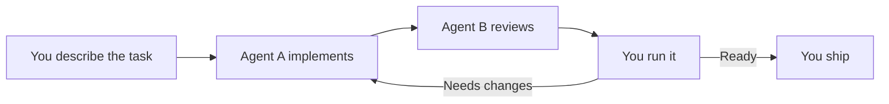

# Work with two agents

Use GitHub Copilot and OpenCode in the same project. Start with one agent implementing a small change. Ask the other to review the diff before you accept it.

Avoid having both agents edit the same files at the same time. For parallel implementation, use separate Git worktrees and review each branch before merging.

## Keep the loop short



You can swap the agents' roles. Give the reviewer the acceptance criteria and ask for bugs or missing behavior.

```text
Review the current diff against this goal:
[paste the goal and acceptance criteria]

Do not edit files. Report bugs and missing behavior.
For each finding, name the file and explain how to reproduce it.
If you find no issues, say so and name anything you could not check.
```

## Give the next agent enough context

Ask the implementing agent to leave a handoff:

```text
Summarize what you changed, the commands you ran, and their results.
List any unfinished work or assumptions I should check.
Keep the handoff short enough to paste into another agent.
```

Run the app and check the behavior yourself. Read the diff, run the project's checks, and commit a working increment before starting the next task.
