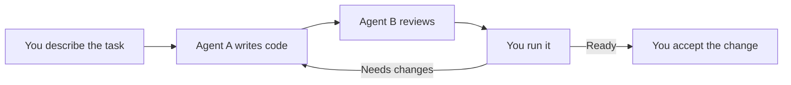

# Work with two agents

Give one agent a small coding task. After it stops, ask a different agent to review the change. The reviewer reads the code and reports problems without changing files.

Use this guide with [level 4](level-4-review.md) and [level 5](level-5-context.md). You can use the same coding app for both workers. Copilot calls a general worker `general-purpose`; OpenCode calls it `general`. Ask your facilitator to help you start one, or use a separate chat for the review.

Keep one agent in charge of file changes at a time.

## Keep the loop short



Give the reviewer your brief, changed files, before-and-after copies, and check results. Your first agent can prepare those copies without Git. After creating `check-work` in level 3, give this prompt to the reviewer. In OpenCode, use `@check-work`:

```text
/check-work Review this change against BRIEF.md.
Read the supplied files and before-and-after copies.
Run our checks. Do not edit files.
Look for examples that fail and features that no longer work.
For each problem, name the file and steps to make it happen.
Tell me what you checked, even if you find no problems.
```

Wait for the reviewer's response. Until then, record "review pending." The first agent checking its own code does not count as a separate review.

## Give the next agent enough context

A **handoff** is a short note that helps the next agent continue your project. Ask the agent that wrote the code to leave one. Use `@stop-slop` in OpenCode:

```text
/stop-slop Write HANDOFF.md for the next agent.
Include what changed, what works, decisions, and where to find the files.
Record check results, unfixed problems, and the next task from BRIEF.md.
Keep it short. Do not change the app.
```

Read the note, then start a new chat in the project and ask the next agent to read it and `AGENTS.md` before editing. [Level 5](level-5-context.md) walks through that transfer.

## Check the result yourself

Try any problem the reviewer reports. Ask the first agent to fix confirmed problems, then run your skill again:

```text
/check-work Run the checks after the fixes.
Show whether the reported problems are gone and earlier examples still work.
Report anything you could not check.
```

Use `@check-work` in OpenCode. Try the feature yourself and compare it with your brief before accepting the change.
